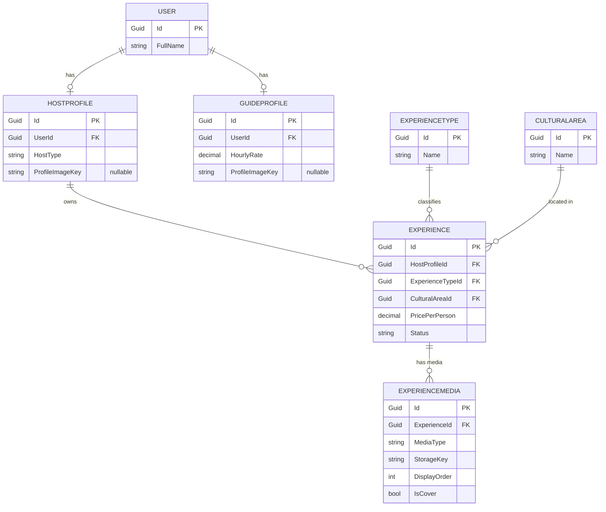
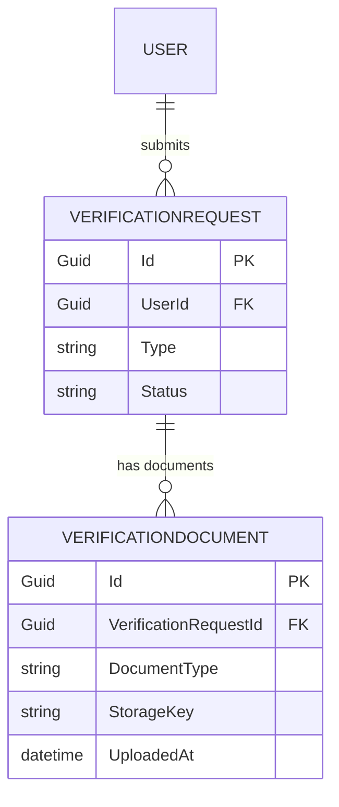
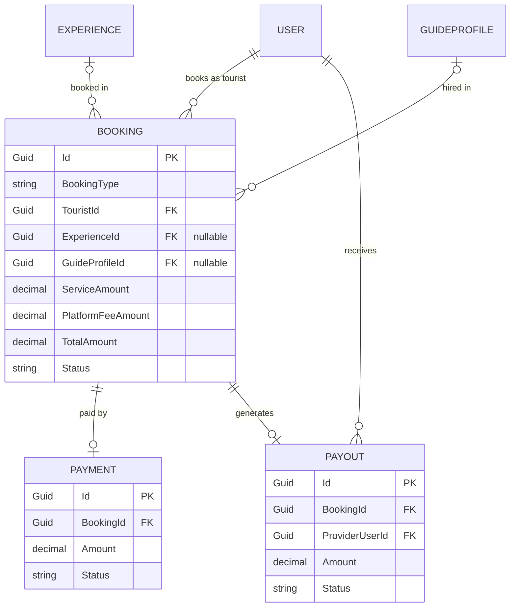
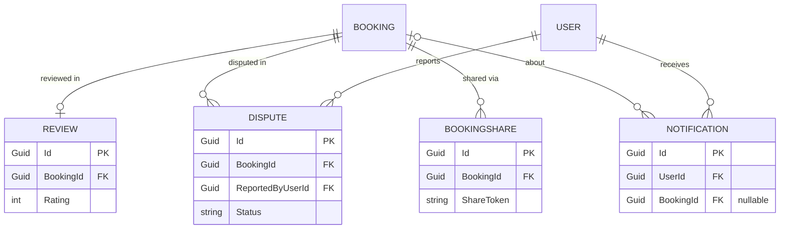
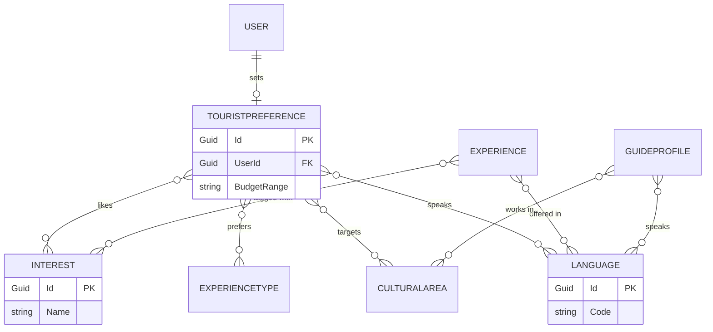

# Discover Egypt — الـ ERD النهائي

> آخر تحديث: 2026-10-04
> الحالة: النسخة النهائية بعد إضافة قواعد الوسائط والملفات (`ExperienceMedia` و`VerificationDocuments` و`ProfileImageKey`)، وجاهزة لتوثيق الـ Classes Specs
> التقنيات: SQL Server · EF Core · ASP.NET Core Identity (`IdentityUser<Guid>`) · كل الـ Primary Keys من نوع `Guid`
> قواعد المشروع وسجل القرارات في ملف `DEPI GP Context.md`
> الملفات (صور وفيديوهات التجارب وصور البروفايل ومستندات التوثيق) بتتخزن **برا الـ Database** في Object Storage، والـ Database بتخزن بس الـ `StorageKey`

---

## 1. إزاي تقرأ الملف ده

الـ ERD هو **خريطة للـ Database**: بتقول إيه الجداول، وفي كل جدول إيه الأعمدة، وإزاي الجداول مربوطة ببعض.

| المصطلح | معناه |
|---|---|
| **Table (جدول)** | زي ورقة Excel. بيمثل حاجة واحدة في المشروع (مستخدم، حجز، دفعة…) |
| **Row (صف)** | سطر واحد في الجدول = حاجة واحدة (مستخدم واحد، حجز واحد) |
| **PK** (Primary Key) | رقم هوية فريد لكل صف (`Guid`) |
| **FK** (Foreign Key) | عمود فيه رقم هوية صف من جدول تاني. زي `TouristId` في الحجز: بيقول مين صاحب الحجز |
| **NN / NULL** | `NN` = إلزامي (مينفعش يفضل فاضي). `NULL` = اختياري (ممكن يفضل فاضي) |
| **UNIQUE** | القيمة متتكررش في جدول (مثلاً مفيش Payment تانية لنفس الحجز) |
| **CHECK** | قاعدة بتتأكد منها الـ Database نفسها (مثلاً السعر أكبر من صفر) |
| **Index** | زي فهرس الكتاب: بيخلّي البحث أسرع |
| **Snapshot** | نسخة من السعر أو النسبة بتتحفظ في الحجز وقت الحجز، عشان تغيير السعر بعدين ميغيّرش الحجوزات القديمة |
| **Join table (جدول ربط)** | جدول صغير بيربط جدولين علاقتهم "كتير لكتير" (M:N) |

**علامات العلاقات في الرسومات:**

| العلامة | المعنى |
|---|---|
| `\|\|` | واحد بالظبط |
| `o\|` | صفر أو واحد (اختياري) |
| `o{` | صفر أو كتير |
| `\|{` | واحد أو كتير |

مثال: `USER ||--o{ BOOKING` يعني المستخدم الواحد ممكن يعمل صفر أو كتير حجوزات، والحجز الواحد ليه مستخدم واحد بالظبط.

---

## 2. الصورة الكبيرة

المشروع فيه **26 جدول** (غير جداول Identity الجاهزة) في 6 مجموعات:

| # | المجموعة | الجداول | بتخدم إيه |
|---|---|---|---|
| 1 | الحسابات | `Users`, `Roles`, `UserRoles` | تسجيل الدخول والأدوار (Tourist, Host, Guide, Admin) |
| 2 | الملفات والتوثيق | `HostProfiles`, `GuideProfiles`, `VerificationRequests`, `VerificationDocuments` | بيانات الـ Host والـ Guide واعتماد الـ Admin ليهم، ومستنداتهم السرية (رقم قومي، رخصة Guide) |
| 3 | التجارب والتصنيفات | `Experiences`, `ExperienceMedia`, `ExperienceTypes`, `CulturalAreas`, `Interests`, `Languages` + 4 جداول ربط | التجارب اللي الـ Host بينشرها وصورها وفيديوهاتها |
| 4 | تفضيلات السائح | `TouristPreferences` + 4 جداول ربط | اللي السائح بيحبه (للتوصيات) |
| 5 | الحجز والفلوس | `Bookings`, `Payments`, `Payouts` | قلب النظام |
| 6 | بعد الحجز | `Reviews`, `Disputes`, `Notifications`, `BookingShares` | التقييم والشكاوى والإشعارات والمشاركة الآمنة |

**الفكرة الأساسية:** الحجز (`Bookings`) بيخص **مقدّم خدمة واحد**: يا تجربة (بيوافق عليها الـ Host) يا Guide (بيوافق عليه الـ Guide). ولكل حجز دفعة واحدة (`Payments`) وPayout واحد (`Payouts`) للمقدّم.

**قاعدة التخزين:** مفيش ملفات (صور أو فيديو أو مستندات) جوه الـ Database. الملفات في Object Storage خارجي (المزوّد لسه ما اتحددش)، والـ Database بتخزن بس `StorageKey` (مفتاح الملف) ومعلومات عنه، ومفيش URL دائم متخزن. مستندات التوثيق في Storage **خاص**.

---

## 3. الرسومات

> الرسومات مكتوبة بـ Mermaid. بتظهر في GitHub وVS Code (Markdown Preview) وNotion. لو مش بتظهر عندك، انسخ الكود في https://mermaid.live. ومفيش مشكلة لو مظهرتش، لأن قسم 4 بيقول نفس العلاقات بالكلام.

### 3.1 الناس والتجارب (ومعاها وسائط التجربة)

### 3.2 التوثيق (مستندات سرية)

### 3.3 الحجز والفلوس

### 3.4 اللي بعد الحجز

### 3.5 التفضيلات والتصنيفات (علاقات كتير لكتير)

كل خط `}o--o{` بيتحول في الـ Database لجدول ربط (Join table)، وهي موضحة في قسم 5.

---

## 4. العلاقات بالكلام

| # | العلاقة | معناها | النوع | الـ FK (في الجدول الابن) | NULL؟ | عند الحذف |
|---|---|---|---|---|---|---|
| 1 | User ↔ Role | كل حساب له دور واحد بس | 1:1 فعلياً (بـ UNIQUE) | `UserRoles(UserId, RoleId)` | – | Cascade |
| 2 | User → HostProfile | حساب الـ Host له Profile واحد | 1:0..1 | `HostProfiles.UserId` (UNIQUE) | NN | Restrict |
| 3 | User → GuideProfile | حساب الـ Guide له Profile واحد | 1:0..1 | `GuideProfiles.UserId` (UNIQUE) | NN | Restrict |
| 4 | User → TouristPreference | السائح عنده تفضيلات واحدة | 1:0..1 | `TouristPreferences.UserId` (UNIQUE) | NN | Cascade |
| 5 | User → VerificationRequest | المستخدم يقدر يقدّم طلبات توثيق | 1:M | `UserId` | NN | Restrict |
| 6 | User (Admin) → VerificationRequest | مين الـ Admin اللي راجع الطلب | 1:M | `ReviewedByUserId` | **NULL** (لسه متراجعش) | Restrict |
| 7 | User → Notification | المستخدم بيستلم إشعارات | 1:M | `Notifications.UserId` | NN | Cascade |
| 8 | HostProfile → Experience | الـ Host بيملك تجارب كتير | 1:M | `Experiences.HostProfileId` | NN | Restrict |
| 9 | ExperienceType → Experience | النوع فيه تجارب كتير | 1:M | `ExperienceTypeId` | NN | Restrict |
| 10 | CulturalArea → Experience | المنطقة فيها تجارب كتير | 1:M | `CulturalAreaId` | NN | Restrict |
| 11 | User (Admin) → Experience | مين الـ Admin اللي راجع التجربة | 1:M | `Experiences.ReviewedByUserId` | **NULL** | Restrict |
| 12 | Experience ↔ Interest | التجربة ليها اهتمامات كتير، والاهتمام ليه تجارب كتير | M:N | `ExperienceInterests` | – | Cascade من Experience |
| 13 | Experience ↔ Language | التجربة بتتقدم بلغات كتير | M:N | `ExperienceLanguages` | – | Cascade من Experience |
| 14 | GuideProfile ↔ Language | الـ Guide بيتكلم لغات كتير | M:N | `GuideLanguages` | – | Cascade من Guide |
| 15 | GuideProfile ↔ CulturalArea | الـ Guide بيشتغل في مناطق كتير | M:N | `GuideCulturalAreas` | – | Cascade من Guide |
| 16 | TouristPreference ↔ Interest / ExperienceType / CulturalArea / Language | السائح بيختار أكتر من اختيار | M:N × 4 | `TouristInterests`, `TouristExperienceTypes`, `TouristCulturalAreas`, `TouristLanguages` | – | Cascade من Preference |
| 17 | User (Tourist) → Booking | السائح بيعمل حجوزات كتير | 1:M | `Bookings.TouristId` | NN | Restrict |
| 18 | Experience → Booking | التجربة ليها حجوزات كتير | 1:M | `Bookings.ExperienceId` | **NULL** (حجز الـ Guide مفيهوش تجربة) | Restrict |
| 19 | GuideProfile → Booking | الـ Guide ليه حجوزات كتير | 1:M | `Bookings.GuideProfileId` | **NULL** (حجز التجربة مفيهوش Guide) | Restrict |
| 20 | Booking → Payment | الحجز ليه دفعة واحدة | 1:0..1 | `Payments.BookingId` (UNIQUE) | NN | Restrict |
| 21 | Booking → Payout | الحجز ليه Payout واحد للمقدّم | 1:0..1 | `Payouts.BookingId` (UNIQUE) | NN | Restrict |
| 22 | User (Provider) → Payout | المقدّم (Host أو Guide) بيستلم Payouts | 1:M | `Payouts.ProviderUserId` | NN | Restrict |
| 23 | Booking → Review | الحجز ليه تقييم واحد | 1:0..1 | `Reviews.BookingId` (UNIQUE) | NN | Restrict |
| 24 | Booking → Dispute | الحجز ممكن يتفتح عليه أكتر من شكوى | 1:M | `Disputes.BookingId` | NN | Restrict |
| 25 | User → Dispute | اللي بلّغ عن المشكلة | 1:M | `Disputes.ReportedByUserId` | NN | Restrict |
| 26 | User (Admin) → Dispute | اللي حلّ الشكوى | 1:M | `Disputes.ResolvedByUserId` | **NULL** | Restrict |
| 27 | Booking → BookingShare | الحجز ممكن يتشارك أكتر من مرة | 1:M | `BookingShares.BookingId` | NN | Restrict |
| 28 | Booking → Notification | إشعار عن حجز معيّن (اختياري) | 1:M | `Notifications.BookingId` | **NULL** | Restrict |
| 29 | Experience → ExperienceMedia | التجربة ليها صور وفيديوهات في جدول واحد | 1:M | `ExperienceMedia.ExperienceId` | NN | Cascade |
| 30 | VerificationRequest → VerificationDocument | طلب التوثيق ليه مستندات (سرية) | 1:M | `VerificationDocuments.VerificationRequestId` | NN | Cascade |

**ليه الـ Payment والـ Payout "1:0..1" وليس "1:1"؟** لأن الـ Database ممكن تمنع وجود دفعة من غير حجز، لكن مش ممكن تجبر كل حجز على دفعة (الحجز بيتعمل قبل الدفعة في نفس العملية). فكون الحجز له دفعة بيتضمن من الكود في Transaction واحدة.

**حدود الوسائط (صورة على الأقل، 8 صور، فيديوهين، كوفر واحد) مش جزء من نوع العلاقة 1:M** (العلاقة 1:M زي ما هي). الحدود دي بتتحقق بقيود على جدول `ExperienceMedia` وبقواعد الـ Domain/Service، والتفصيل في قسم 5.7.

---

## 5. الجداول بالتفصيل

**قراءة الجداول:** النوع هو نوع SQL Server (الـ `Guid` في C# بيتحول لـ `uniqueidentifier`). الأوقات `datetime2(0)` بتوقيت UTC. الـ Enums بتتخزن `varchar` مع `CHECK`.

### 5.1 الحسابات

#### `Users` (من ASP.NET Identity، `IdentityUser<Guid>`)
مين كل حساب في المنصة.

| العمود | النوع | Null؟ | ملاحظات |
|---|---|---|---|
| `Id` | Guid | PK | |
| `FullName` | nvarchar(150) | NN | |
| `Country` | nvarchar(100) | NULL | |
| `IsActive` | bit | NN | الافتراضي 1. بنستخدمه بدل حذف المستخدم |
| `CreatedAt` | datetime2(0) | NN | |
| أعمدة Identity | – | – | `Email` و`NormalizedEmail` (UNIQUE) و`PhoneNumber` و`PasswordHash`… جاهزة من Identity |

#### `Roles` و`UserRoles` (من Identity)
`Roles` فيه 4 أدوار ثابتة (Seed): Tourist, Host, Guide, Admin. و`UserRoles` بيربط المستخدم بدوره.
- `PK(UserId, RoleId)` و**`UNIQUE(UserId)`** عشان كل حساب ليه دور واحد بس.
- باقي جداول Identity (`UserClaims`, `UserLogins`, `RoleClaims`, `UserTokens`) بتفضل زي ما هي.

### 5.2 الملفات والتوثيق

#### `HostProfiles`
بيانات الـ Host (العائلة أو الحرفي…).

| العمود | النوع | Null؟ | ملاحظات |
|---|---|---|---|
| `Id` | Guid | PK | |
| `UserId` | Guid | NN | FK → `Users`، **UNIQUE** |
| `HostType` | varchar(15) | NN | Family / Individual / Artisan / Farmer |
| `DisplayName` | nvarchar(150) | NN | |
| `Bio` | nvarchar(2000) | NULL | |
| `ProfileImageKey` | varchar(500) | NULL | مفتاح صورة البروفايل في الـ Storage (مش URL). اختياري |
| `CreatedAt` | datetime2(0) | NN | |

#### `GuideProfiles`
بيانات الـ Guide وأجره بالساعة.

| العمود | النوع | Null؟ | ملاحظات |
|---|---|---|---|
| `Id` | Guid | PK | |
| `UserId` | Guid | NN | FK → `Users`، **UNIQUE** |
| `HourlyRate` | decimal(10,2) | NN | `CHECK > 0` |
| `Bio` | nvarchar(2000) | NN | |
| `ProfileImageKey` | varchar(500) | NULL | مفتاح صورة البروفايل في الـ Storage (مش URL). اختياري |
| `CreatedAt` | datetime2(0) | NN | |

#### `VerificationRequests`
طلبات اعتماد الـ Host والـ Guide عند الـ Admin. هو المصدر الوحيد لمعرفة هل الـ Host أو الـ Guide معتمد (مفيش `IsVerified`).

| العمود | النوع | Null؟ | ملاحظات |
|---|---|---|---|
| `Id` | Guid | PK | |
| `UserId` | Guid | NN | FK → `Users` (اللي قدّم الطلب) |
| `Type` | varchar(10) | NN | Host / Guide |
| `Status` | varchar(10) | NN | Pending / Approved / Rejected |
| `SubmittedAt` | datetime2(0) | NN | |
| `ReviewedAt` | datetime2(0) | NULL | بيتملا بعد المراجعة |
| `ReviewedByUserId` | Guid | NULL | FK → `Users` (الـ Admin) |
| `RejectionReason` | nvarchar(1000) | NULL | إلزامي لو الطلب اترفض |

**القيود والـ Indexes:**
- طلب معلّق واحد بس لكل مستخدم: `UNIQUE(UserId) WHERE Status='Pending'`.
- اعتماد واحد بس لكل مستخدم: `UNIQUE(UserId) WHERE Status='Approved'`.
- طابور الـ Admin: `INDEX(Status, SubmittedAt)`.
- `CHECK(Status<>'Rejected' OR RejectionReason IS NOT NULL)`.
- `CHECK(Status='Pending' OR (ReviewedAt IS NOT NULL AND ReviewedByUserId IS NOT NULL))`.

#### `VerificationDocuments`
المستندات اللي الـ Host أو الـ Guide بيرفعها مع طلب التوثيق (بطاقة الرقم القومي، رخصة الـ Guide). **سرية وحساسة**: مش وسائط عامة، ومش جزء من `ExperienceMedia`، ومبتتعرضش للسائحين.

| العمود | النوع | Null؟ | ملاحظات |
|---|---|---|---|
| `Id` | Guid | PK | |
| `VerificationRequestId` | Guid | NN | FK → `VerificationRequests` |
| `DocumentType` | varchar(20) | NN | NationalId / GuideLicense |
| `StorageKey` | varchar(500) | NN | **UNIQUE**. مفتاح الملف في الـ Storage **الخاص** (مش URL) |
| `UploadedAt` | datetime2(0) | NN | |

**القواعد:**
- العلاقة **1:M**: طلب التوثيق الواحد ليه مستندات كتير، والمستند ليه طلب واحد. `Cascade` من `VerificationRequests` (بيانات مملوكة)، و`INDEX(VerificationRequestId)`.
- الـ Guide ممكن يرفع `NationalId` + `GuideLicense`. الـ Host ممكن يرفع `NationalId`. الـ DB مبتعرفش نوع الطلب من جدول المستندات (محتاجة `VerificationRequests.Type`)، فالقاعدة دي بتتأكد منها طبقة الـ Service.
- الـ DB مش بتحدد عدد الملفات لكل نوع (ممكن وش وضهر مثلاً). أي حد لعدد الملفات يبقى قاعدة Service.
- الملفات في Storage خاص برا الـ Database، والـ Database بتخزن بس الـ metadata والـ `StorageKey`.
- الوصول للمستندات لازم يعدّي على الـ Backend بعد التحقق من الصلاحية (الـ Admin، وصاحب الطلب لمستنداته هو). **ممنوع** إنشاء URL عام دائم لأي مستند.
- حالة التوثيق بتفضل من `VerificationRequests` بس. **مفيش `IsVerified`** على `HostProfiles` أو `GuideProfiles`.

### 5.3 التجارب والتصنيفات

#### جداول التصنيف (Lookups)
قوايم ثابتة بتتملا مرة واحدة (Seed) بـ Guids ثابتة.

| الجدول | الأعمدة | القيم الأولية |
|---|---|---|
| `ExperienceTypes` | `Id` PK, `Name` nvarchar(100) NN **UNIQUE** | Food & Cooking, Cultural Experience, Arts & Crafts, Local Tours, Workshops, Community Experiences |
| `CulturalAreas` | `Id` PK, `Name` nvarchar(100) NN **UNIQUE** | Cairo, Giza, Alexandria, Luxor, Aswan, Red Sea, Other |
| `Interests` | `Id` PK, `Name` nvarchar(100) NN **UNIQUE** | Egyptian Food, Local Culture, History, Arts & Crafts, Traditional Markets, Local Communities, Nature, Family Experiences, Workshops, Egyptian Traditions |
| `Languages` | `Id` PK, `Code` varchar(10) NN **UNIQUE**, `Name` nvarchar(60) NN **UNIQUE** | English, Arabic, French, German, Spanish |

#### `Experiences`
التجربة اللي الـ Host بينشرها. مش بتظهر للسائحين غير لما تتنشر بموافقة الـ Admin ويبقى ليها صورة واحدة على الأقل.

| العمود | النوع | Null؟ | ملاحظات |
|---|---|---|---|
| `Id` | Guid | PK | |
| `HostProfileId` | Guid | NN | FK → `HostProfiles` |
| `ExperienceTypeId` | Guid | NN | FK → `ExperienceTypes` |
| `CulturalAreaId` | Guid | NN | FK → `CulturalAreas` |
| `Title` | nvarchar(200) | NN | |
| `Description` | nvarchar(4000) | NN | |
| `CulturalStory` | nvarchar(4000) | NN | **إلزامي**، ومينفعش يبقى فاضي (`CHECK(LEN(TRIM(CulturalStory))>0)`) |
| `PricePerPerson` | decimal(10,2) | NN | `CHECK > 0` |
| `DurationMinutes` | int | NN | `CHECK > 0` |
| `MaxGroupSize` | int | NN | `CHECK >= 1` |
| `MeetingPoint` | nvarchar(300) | NN | بيتستخدم في مشاركة الحجز |
| `Status` | varchar(15) | NN | Draft / PendingApproval / Published / Rejected / Unpublished |
| `SubmittedAt` | datetime2(0) | NULL | وقت الإرسال للمراجعة |
| `ReviewedAt` | datetime2(0) | NULL | |
| `ReviewedByUserId` | Guid | NULL | FK → `Users` (الـ Admin) |
| `RejectionReason` | nvarchar(1000) | NULL | إلزامي لو التجربة اترفضت |
| `CreatedAt` | datetime2(0) | NN | |
| `UpdatedAt` | datetime2(0) | NULL | |
| `RowVersion` | rowversion | NN | لمنع تعارض التعديلات |

**القيود والـ Indexes:**
- التجارب المنشورة (للـ Explore): `INDEX(CulturalAreaId, ExperienceTypeId, PricePerPerson) INCLUDE(DurationMinutes, CreatedAt, Title) WHERE Status='Published'`.
- تجارب الـ Host: `INDEX(HostProfileId)`.
- طابور موافقة الـ Admin: `INDEX(SubmittedAt) WHERE Status='PendingApproval'`.
- `CHECK(Status<>'Rejected' OR RejectionReason IS NOT NULL)`.
- `CHECK(Status<>'Published' OR (ReviewedAt IS NOT NULL AND ReviewedByUserId IS NOT NULL))`.
- **صورة واحدة على الأقل عشان التجربة تتنشر:** قاعدة أساسية في الـ Backend وليست validation في الـ UI بس. الـ Database مبتقدرش تعملها `CHECK` لأنها بتعتمد على جدول `ExperienceMedia`، فالـ Domain/Service لازم يمنع أي انتقال لـ `Published` من غير صورة (تفاصيل في قسم 5.7).

#### `ExperienceMedia`
صور وفيديوهات التجربة، في **جدول واحد** (مفيش جدول منفصل للصور وجدول للفيديوهات). الملفات نفسها في Object Storage، والجدول بيخزن مفتاح الملف.

| العمود | النوع | Null؟ | ملاحظات |
|---|---|---|---|
| `Id` | Guid | PK | |
| `ExperienceId` | Guid | NN | FK → `Experiences` |
| `MediaType` | varchar(10) | NN | Image / Video |
| `StorageKey` | varchar(500) | NN | **UNIQUE**. مفتاح الملف في الـ Storage (مش URL) |
| `DisplayOrder` | int | NN | ترتيب العرض **جوه نفس النوع**: من 1 لـ 8 للصور، ومن 1 لـ 2 للفيديوهات |
| `IsCover` | bit | NN | الافتراضي 0. الصورة الأساسية للتجربة (صورة فقط) |
| `CreatedAt` | datetime2(0) | NN | |

**القواعد النهائية:**
- العلاقة مع `Experiences` **1:M**، و`Cascade` من التجربة (بيانات مملوكة).
- **الصور:** صورة واحدة على الأقل للنشر، و8 كحد أقصى. **الفيديوهات:** اختيارية (صفر مسموح)، و2 كحد أقصى. يعني من 1 صورة + 0 فيديو لحد 8 صور + 2 فيديو.
- كوفر واحد كحد أقصى، ولازم يكون صورة.

**القيود في الـ Database:**
- `CHECK(MediaType IN ('Image','Video'))`.
- `CHECK((MediaType='Image' AND DisplayOrder BETWEEN 1 AND 8) OR (MediaType='Video' AND DisplayOrder BETWEEN 1 AND 2))`.
- `UNIQUE(ExperienceId, MediaType, DisplayOrder)`: القيدين دول مع بعض بيضمنوا إن مستحيل يبقى فيه أكتر من 8 صور أو أكتر من فيديوهين لنفس التجربة، حتى لو رفعين اتعملوا في نفس اللحظة. من غير جدول جديد.
- `UNIQUE(ExperienceId) INCLUDE(StorageKey) WHERE IsCover = 1`: كوفر واحد كحد أقصى (وبيسرّع جلب صورة الكوفر في الـ Explore).
- `CHECK(IsCover = 0 OR MediaType = 'Image')`: الكوفر صورة بس.
- `UNIQUE(StorageKey)`.

**قواعد لازم الـ Domain/Service يضمنها كمان** (الـ DB مبتقدرش عليها أو محتاجة رسالة خطأ مفهومة): صورة واحدة على الأقل قبل النشر، وكوفر صالح لكل تجربة منشورة، واختيار أول `DisplayOrder` فاضي عند الرفع. التفاصيل في قسم 5.7.

#### جداول الربط الخاصة بالتجارب والـ Guides

| الجدول | الـ PK المركّب | بيربط | Index إضافي |
|---|---|---|---|
| `ExperienceInterests` | `(ExperienceId, InterestId)` | التجربة بالاهتمامات (بتتحسب منها نسبة التوصية 40%) | `(InterestId, ExperienceId)` |
| `ExperienceLanguages` | `(ExperienceId, LanguageId)` | التجربة باللغات | `(LanguageId, ExperienceId)` |
| `GuideLanguages` | `(GuideProfileId, LanguageId)` | الـ Guide باللغات | `(LanguageId, GuideProfileId)` |
| `GuideCulturalAreas` | `(GuideProfileId, CulturalAreaId)` | الـ Guide بالمناطق اللي بيشتغل فيها | `(CulturalAreaId, GuideProfileId)` |

### 5.4 تفضيلات السائح

#### `TouristPreferences`
اللي السائح بيحبه، وبتتحسب منه التوصيات (ميزانية، مدة، تفضيل الـ Guide). الاختيارات المتعددة في جداول الربط تحت.

| العمود | النوع | Null؟ | ملاحظات |
|---|---|---|---|
| `Id` | Guid | PK | |
| `UserId` | Guid | NN | FK → `Users`، **UNIQUE** |
| `BudgetRange` | varchar(15) | NULL | Under500 / From500To800 / From800To1500 / From1500To3000 / Over3000 |
| `DurationRange` | varchar(15) | NULL | Under2h / From2To4h / From4To6h / FullDay |
| `GuidePreference` | varchar(15) | NN | الافتراضي `EitherIsFine`. وبيتحدد بيه هل نعرض "تحب تحجز Guide؟" |

جداول الربط (`PK(TouristPreferenceId, <Lookup>Id)` لكل واحد): `TouristInterests` و`TouristExperienceTypes` و`TouristCulturalAreas` و`TouristLanguages`.

### 5.5 الحجز والفلوس

#### `Bookings`
حجز واحد = مقدّم خدمة واحد. إما حجز تجربة (بيوافق عليه الـ Host) أو حجز Guide (بيوافق عليه الـ Guide).

| العمود | النوع | Null؟ | ملاحظات |
|---|---|---|---|
| `Id` | Guid | PK | |
| `BookingType` | varchar(10) | NN | Experience / Guide |
| `TouristId` | Guid | NN | FK → `Users` |
| `ExperienceId` | Guid | NULL | FK → `Experiences`. بيبقى فاضي في حجز الـ Guide |
| `GuideProfileId` | Guid | NULL | FK → `GuideProfiles`. بيبقى فاضي في حجز التجربة |
| `StartAt` | datetime2(0) | NN | ميعاد البداية اللي السائح طلبه |
| `NumberOfGuests` | int | NN | `CHECK >= 1` |
| `ExperiencePricePerPerson` | decimal(10,2) | NULL | Snapshot، حجز التجربة فقط |
| `GuideHourlyRate` | decimal(10,2) | NULL | Snapshot، حجز الـ Guide فقط |
| `GuideHours` | int | NULL | حجز الـ Guide فقط |
| `Destination` | nvarchar(300) | NULL | الوجهة، حجز الـ Guide فقط (نص حر) |
| `ServiceAmount` | decimal(10,2) | NN | سعر المقدّم. `CHECK > 0` |
| `PlatformFeeRate` | decimal(5,4) | NN | Snapshot من نسبة الرسوم. `CHECK` بين 0 و1 |
| `PlatformFeeAmount` | decimal(10,2) | NN | `CHECK >= 0` |
| `TotalAmount` | decimal(10,2) | NN | اللي السائح بيدفعه |
| `Status` | varchar(10) | NN | Pending / Confirmed / Rejected / Cancelled / Completed |
| `CreatedAt` | datetime2(0) | NN | |
| `CompletedAt` | datetime2(0) | NULL | |
| `CancelledAt` | datetime2(0) | NULL | |
| `RowVersion` | rowversion | NN | |

**القيود (بتتأكد منها الـ Database):**
1. واحد بس من `ExperienceId` و`GuideProfileId` يبقى مليان: `CHECK((ExperienceId IS NULL) <> (GuideProfileId IS NULL))`.
2. نوع الحجز مطابق: `BookingType='Experience'` ⇔ `ExperienceId` موجود، و`'Guide'` ⇔ `GuideProfileId` موجود.
3. حجز التجربة: `ExperiencePricePerPerson` موجود، و`GuideHourlyRate` و`GuideHours` و`Destination` فاضيين، و`ServiceAmount = ExperiencePricePerPerson × NumberOfGuests`.
4. حجز الـ Guide: `GuideHourlyRate` و`GuideHours` (أكبر من 0) و`Destination` موجودين، و`ExperiencePricePerPerson` فاضي، و`ServiceAmount = GuideHourlyRate × GuideHours`.
5. `TotalAmount = ServiceAmount + PlatformFeeAmount`.
6. `Completed` ⇒ `CompletedAt` موجود. و`Cancelled` ⇒ `CancelledAt` موجود.

**الـ Indexes:**
- حجوزات السائح: `(TouristId, Status, StartAt DESC)`.
- حجوزات التجربة (للـ Host): `(ExperienceId, Status, StartAt) WHERE ExperienceId IS NOT NULL`.
- حجوزات الـ Guide: `(GuideProfileId, Status, StartAt) WHERE GuideProfileId IS NOT NULL`.
- مهلة الرد على الحجوزات المعلّقة: `(CreatedAt) WHERE Status='Pending'`.

#### `Payments`
فلوس السائح للمنصة (Mock/Sandbox). دفعة واحدة لكل حجز.

| العمود | النوع | Null؟ | ملاحظات |
|---|---|---|---|
| `Id` | Guid | PK | |
| `BookingId` | Guid | NN | FK → `Bookings`، **UNIQUE** |
| `Amount` | decimal(10,2) | NN | بيتساوى مع `Bookings.TotalAmount` وقت الإنشاء |
| `Status` | varchar(10) | NN | Pending / Paid / Refunded / Failed |
| `Method` | varchar(20) | NN | قيم الـ Mock (لسه هتتحدد) |
| `TransactionReference` | varchar(64) | NN | **UNIQUE** |
| `PaidAt` | datetime2(0) | NULL | |
| `RefundAmount` | decimal(10,2) | NULL | الكلي أو الجزئي |
| `RefundedAt` | datetime2(0) | NULL | |
| `RowVersion` | rowversion | NN | |

**القيود:** `Paid` ⇒ `PaidAt` موجود. و`Refunded` ⇒ `RefundAmount` أكبر من 0 وأقل من أو يساوي `Amount` و`RefundedAt` موجود.

#### `Payouts`
فلوس المنصة للـ Host أو الـ Guide. Payout واحد لكل حجز.

| العمود | النوع | Null؟ | ملاحظات |
|---|---|---|---|
| `Id` | Guid | PK | |
| `BookingId` | Guid | NN | FK → `Bookings`، **UNIQUE** |
| `ProviderUserId` | Guid | NN | FK → `Users`. بيشاور على حساب الـ Host أو الـ Guide اللي هيستلم الفلوس |
| `Amount` | decimal(10,2) | NN | `CHECK > 0`. نفس `ServiceAmount` (100% للمقدّم) |
| `Status` | varchar(10) | NN | Pending / Paid / Cancelled |
| `CreatedAt` | datetime2(0) | NN | بيتنشأ لما الحجز يبقى `Confirmed` |
| `PaidAt` | datetime2(0) | NULL | |
| `RowVersion` | rowversion | NN | |

**القيود والـ Index:** `CHECK((Status='Paid') = (PaidAt IS NOT NULL))`، و`INDEX(ProviderUserId, Status) INCLUDE(Amount)` للوحة أرباح المقدّم.

### 5.6 بعد الحجز

#### `Reviews`
تقييم حجز اتكمّل. لو الحجز تجربة فهو تقييم للتجربة والـ Host، ولو الحجز Guide فهو تقييم للـ Guide.

| العمود | النوع | Null؟ | ملاحظات |
|---|---|---|---|
| `Id` | Guid | PK | |
| `BookingId` | Guid | NN | FK → `Bookings`، **UNIQUE** (تقييم واحد لكل حجز) |
| `Rating` | tinyint | NN | `CHECK` بين 1 و5. بيتعرض رقم زي "4.9 · 128 reviews" من غير نجوم |
| `Comment` | nvarchar(2000) | NULL | |
| `CreatedAt` | datetime2(0) | NN | |

#### `Disputes`
شكاوى على حجز معيّن، بيحلها الـ Admin.

| العمود | النوع | Null؟ | ملاحظات |
|---|---|---|---|
| `Id` | Guid | PK | |
| `BookingId` | Guid | NN | FK → `Bookings` |
| `ReportedByUserId` | Guid | NN | FK → `Users` |
| `Reason` | nvarchar(200) | NN | |
| `Description` | nvarchar(2000) | NN | |
| `Status` | varchar(15) | NN | Open / UnderReview / Resolved / Refunded / Closed |
| `CreatedAt` | datetime2(0) | NN | |
| `ResolvedAt` | datetime2(0) | NULL | |
| `ResolvedByUserId` | Guid | NULL | FK → `Users` (الـ Admin) |
| `ResolutionNote` | nvarchar(2000) | NULL | |

**الـ Indexes:** `(Status, CreatedAt)` لطابور الـ Admin، و`(BookingId)`، و`UNIQUE(BookingId, ReportedByUserId) WHERE Status IN ('Open','UnderReview')` لمنع شكوى مفتوحة مكررة.

#### `Notifications`
إشعارات المستخدمين.

| العمود | النوع | Null؟ | ملاحظات |
|---|---|---|---|
| `Id` | Guid | PK | |
| `UserId` | Guid | NN | FK → `Users` |
| `BookingId` | Guid | NULL | FK → `Bookings` (لو الإشعار عن حجز) |
| `Title` | nvarchar(150) | NN | |
| `Message` | nvarchar(500) | NN | |
| `Type` | varchar(30) | NN | شوف قسم 6 |
| `IsRead` | bit | NN | الافتراضي 0 |
| `CreatedAt` | datetime2(0) | NN | |

**الـ Index:** `(UserId, IsRead, CreatedAt DESC)`.

#### `BookingShares`
مشاركة تفاصيل الحجز مع شخص موثوق للأمان (لينك للقراءة فقط، من غير بيانات الدفع).

| العمود | النوع | Null؟ | ملاحظات |
|---|---|---|---|
| `Id` | Guid | PK | |
| `BookingId` | Guid | NN | FK → `Bookings` |
| `RecipientName` | nvarchar(150) | NULL | |
| `RecipientEmail` | nvarchar(256) | NN | |
| `ShareToken` | varchar(64) | NN | **UNIQUE**، عشوائي ومش متوقع |
| `CreatedAt` | datetime2(0) | NN | |
| `ExpiresAt` | datetime2(0) | NULL | |

**الـ Index:** `(BookingId)`.

### 5.7 الوسائط والملفات — القواعد النهائية وأين بتتأكد

القواعد دي نهائية. عمود "الـ Database" بيقول هل قيود الـ DB نفسها بتضمن القاعدة، وعمود "الـ Domain / Service" بيقول هل لازم الكود يتأكد منها كمان. في القواعد اللي الـ DB مبتقدرش عليها، الكود هو الضمان الوحيد.

| # | القاعدة | الـ Database | الـ Domain / Service |
|---|---|---|---|
| 1 | `ExperienceMedia` → `Experiences` علاقة 1:M | FK + `Cascade` | – |
| 2 | 8 صور كحد أقصى لكل تجربة | نعم: `UNIQUE(ExperienceId, MediaType, DisplayOrder)` مع `CHECK` إن ترتيب الصورة من 1 لـ 8 | لازم كمان، عشان رسالة خطأ واضحة واختيار أول مكان فاضي |
| 3 | فيديوهين كحد أقصى لكل تجربة | نعم: نفس القيد، وترتيب الفيديو من 1 لـ 2 | لازم كمان |
| 4 | الفيديو اختياري (من صفر لـ 2) | مفيش قيد، والصفر مسموح | الفيديو مش شرط للنشر أبداً |
| 5 | صورة واحدة على الأقل عشان التجربة تتنشر | **لا**: مينفعش `CHECK` لأنها بتعتمد على جدول تاني | **إلزامي**: قاعدة Domain عند أي انتقال لـ `Published`. (Trigger في الـ DB ممكن يتضاف كطبقة أمان اختيارية) |
| 6 | كوفر واحد كحد أقصى | نعم: `UNIQUE(ExperienceId) WHERE IsCover = 1` | لازم كمان |
| 7 | الكوفر لازم يكون صورة | نعم: `CHECK(IsCover = 0 OR MediaType = 'Image')` | لازم كمان |
| 8 | كل تجربة منشورة ليها كوفر صالح | **لا** | بيتأكد عند النشر وعند أي حذف أو تغيير للصور |
| 9 | الملفات برا الـ Database | `StorageKey` فقط (`NN` و`UNIQUE`)، من غير Binary ولا URL دائم | الـ URL (أو وصول مؤقت) بيتولّد وقت العرض |
| 10 | `VerificationDocuments` → `VerificationRequests` علاقة 1:M | FK + `Cascade` | – |
| 11 | مستندات التوثيق سرية | **لا**: دي مسألة تخزين وصلاحيات | Storage خاص + صلاحيات Admin/صاحب الطلب، ومفيش URL عام دائم |
| 12 | Host: `NationalId` فقط. Guide: `NationalId` + `GuideLicense` | **لا** (محتاجة `VerificationRequests.Type`) | لازم |
| 13 | صورة البروفايل (Host / Guide) | `ProfileImageKey` اختياري | نفس الـ Storage |

**سلوك الـ Domain/Service للوسائط:**
- **النشر:** `Publish()` بيفشل لو الـ Host مش معتمد، أو الـ Admin ما اعتمدش التجربة، أو مفيش صورة، أو مفيش كوفر. بينطبق على النشر لأول مرة وعلى إعادة النشر من `Unpublished`. يعني الـ Admin مش بيقدر "يعتمد" تجربة من غير صورة.
- **الكوفر:** أول صورة بتترفع بتبقى الكوفر تلقائياً. لو الكوفر اتحذفت، الصورة اللي ترتيبها أقل بتبقى الكوفر. تغيير الكوفر بيتم في Transaction واحدة (إلغاء القديمة ثم تعيين الجديدة).
- **الحذف:** مينفعش تتحذف آخر صورة (أو الكوفر من غير بديل) في تجربة `Published`.
- **ترتيب العرض:** `DisplayOrder` بيتحسب جوه كل نوع لوحده (الصور من 1 لـ 8، والفيديوهات من 1 لـ 2)، فالواجهة بتعرض الصور ثم الفيديوهات ومفيش ترتيب مختلط بينهم. وتغيير الترتيب لازم يتم بأمر `UPDATE` واحد (مش صف صف) عشان قيد `UNIQUE` ميتخالفش في النص.
- **التخزين:** حذف صف من `ExperienceMedia` أو `VerificationDocuments` لازم يتبعه حذف الملف من الـ Storage.
- **حدود العدد (8 و2):** قواعد نهائية، ومكتوبة في الـ `CHECK`، فلو اتغيّرت بعدين محتاجة Migration.

---

## 6. الـ Enums (القيم الثابتة)

بتتخزن كنص `varchar` مع `CHECK (… IN (…))`، وفي C# بتتحول بـ `HasConversion<string>()`. مفيش جدول لأي واحد منهم.

| Enum | القيم |
|---|---|
| `BookingType` | Experience, Guide |
| `BookingStatus` | Pending, Confirmed, Rejected, Cancelled, Completed |
| `PaymentStatus` | Pending, Paid, Refunded, Failed |
| `PayoutStatus` | Pending, Paid, Cancelled |
| `ExperienceStatus` | Draft, PendingApproval, Published, Rejected, Unpublished |
| `MediaType` | Image, Video |
| `DocumentType` | NationalId, GuideLicense (أنواع إضافية ممكن تتضاف لاحقاً) |
| `VerificationType` | Host, Guide |
| `VerificationStatus` | Pending, Approved, Rejected |
| `DisputeStatus` | Open, UnderReview, Resolved, Refunded, Closed |
| `HostType` | Family, Individual, Artisan, Farmer |
| `GuidePreference` | GuidePreferred, NoGuideNeeded, EitherIsFine |
| `BudgetRange` | Under500, From500To800, From800To1500, From1500To3000, Over3000 |
| `DurationRange` | Under2h, From2To4h, From4To6h, FullDay |
| `PaymentMethod` | قيم الـ Mock/Sandbox (لسه هتتحدد، قيمة واحدة تكفي) |
| `NotificationType` | NewBooking, BookingStatusUpdate, BookingReminder, PaymentUpdate, DisputeUpdate, VerificationUpdate, ExperienceApprovalUpdate (وممكن `GuideSuggestion` لسؤال "تحب تحجز Guide؟") |

---

## 7. قواعد الحذف (Delete Behavior)

- **`Restrict` هو الأصل:** مفيش حاجة بتتمسح تلقائياً لو فيه حاجة مرتبطة بيها. ده بيحمي الحجوزات والفلوس. الحذف بيتعمل بـ `Users.IsActive=0` أو بتغيير الـ Status.
- **`Cascade` بس للبيانات المملوكة:** `UserRoles`، و`TouristPreferences` (من `Users`)، وجداول الربط (من جهة المالك: Experience أو GuideProfile أو TouristPreference)، و`Notifications.UserId`، و`ExperienceMedia` (من `Experiences`)، و`VerificationDocuments` (من `VerificationRequests`). حذف الصف لازم يتبعه حذف الملف من الـ Storage.
- مفيش `Cascade` على أي حاجة تحت `Bookings`.
- في SQL Server مينفعش أكتر من مسار `Cascade` لنفس الجدول، وده سبب إننا بنستخدم `Restrict` في معظم العلاقات.

---

## 8. قواعد بيتأكد منها الـ Service (مش الـ Database)

الـ `CHECK` مبيشوفش غير الجدول اللي هو فيه، فالقواعد دي بتتأكد منها الـ Services:

- الحجز والـ Payment بيتعملوا في Transaction واحدة، و`Payment.Amount = Booking.TotalAmount`.
- `PlatformFeeAmount = ROUND(ServiceAmount × Rate, 2)` بـ `MidpointRounding.AwayFromZero`.
- المقدّم مبيشوفش الحجز غير لما الـ Payment تبقى `Paid`.
- الـ Host أو الـ Guide لازم يكون معتمد (عنده Request `Approved`) و`IsActive=1`، والتجربة `Published`، وقت الحجز.
- `NumberOfGuests ≤ MaxGroupSize` في حجز التجربة.
- الـ Payout بيتنشأ لما الحجز يبقى `Confirmed` بـ `Amount = ServiceAmount`، وبيتحرر بعد `Completed` إلا لو فيه Dispute مفتوح.
- المقدّم هو اللي بيعلّم `Completed`، ومش قبل `StartAt`.
- الـ Review: الحجز `Completed` ويخص السائح اللي بيقيّم.
- تعديل Title أو Description أو CulturalStory أو MeetingPoint أو DurationMinutes على تجربة `Published` بيرجّعها `PendingApproval`.
- **النشر** (`PendingApproval` أو `Unpublished` ← `Published`) بيتم بأمر واحد في الـ Domain بيتأكد من 3 حاجات: الـ Host معتمد (عنده Request `Approved`)، والـ Admin اعتمد التجربة (`ReviewedBy`)، وفيه صورة واحدة على الأقل ومعاها كوفر. لو واحدة ناقصة النشر بيفشل. دي قاعدة أساسية في الـ Backend، مش validation في الـ UI بس.
- الـ UI بيطلب صورة واحدة على الأقل قبل إرسال التجربة للمراجعة، لكن الضمان الحقيقي عند النشر.
- تعديل الصور أو الفيديوهات على تجربة `Published` مش بيرجّعها `PendingApproval` (مش في قائمة الحقول اللي بترجّعها)، لكن مينفعش يتحذف آخر صورة أو الكوفر من غير بديل.
- قواعد الوسائط والملفات بالتفصيل (الحدود، الكوفر، الخصوصية، التخزين) في قسم 5.7.
- `VerificationRequest.Type` لازم يطابق دور الحساب.
- لما حجز التجربة يبقى `Completed` وتفضيل السائح مش `NoGuideNeeded`، نعرض له "تحب تحجز Guide؟".
- قواعد الإلغاء والـ Refund (24 ساعة = 100%، أقل من 24 ساعة = 50%) وتوزيع المبالغ على المقدّم والمنصة، موضحة في `DEPI GP Context.md`.

---

## 9. الإعدادات (في `appsettings` مش في الـ Database)

| الإعداد | الحالة |
|---|---|
| `ExperienceFeeRate` | قيمة توضيحية 15%، مش نهائية |
| `GuideFeeRate` | مش نهائية، ومن غير قيمة افتراضية (التطبيق يفشل وقت التشغيل لو مش متحددة) |
| `FullRefundHours` | 24 |
| `LateCancelRefundPercent` | 50 |
| مهلة رد المقدّم | تتحدد |
| مهلة الدفع الفاشل | تتحدد |
| أقل عدد ساعات للـ Guide | تتحدد |
| مزوّد الـ Object Storage وطريقة التنفيذ | لسه ما اتحدد |
| أنواع ملفات الصور والفيديو المسموحة | لسه ما اتحددت |
| أقصى حجم للصورة، وأقصى حجم للفيديو | لسه ما اتحدد |

كل حجز بياخد Snapshot من النسبة وقت إنشائه، فتغيير الإعداد مبيمسش الحجوزات القديمة.

---

## 10. مثال عملي

**أحمد** (سائح) حجز "طبخ مصري مع عائلة" عند **منى** (Host) لشخصين، وبعدها حجز **عمر** (Guide) يزور معاه المتحف المصري.

**الحجز الأول: تجربة** (`PricePerPerson` = 800، النسبة 15% كمثال)

| الجدول | الصف |
|---|---|
| `Bookings` | `BookingType`=Experience، `TouristId`=أحمد، `ExperienceId`=تجربة الطبخ، `GuideProfileId`=**NULL**، `NumberOfGuests`=2، `ExperiencePricePerPerson`=800، `ServiceAmount`=**1600**، `PlatformFeeRate`=0.15، `PlatformFeeAmount`=**240**، `TotalAmount`=**1840**، `Status`=Pending |
| `Payments` | `BookingId`=الحجز، `Amount`=**1840**، `Status`=Paid |
| بعد قبول منى | `Bookings.Status`=Confirmed، وبيتنشأ `Payouts`: `ProviderUserId`=منى، `Amount`=**1600**، `Status`=Pending |
| بعد التنفيذ | `Bookings.Status`=Completed، و`Payouts.Status`=Paid |
| `Reviews` | `BookingId`=الحجز، `Rating`=5 (تقييم التجربة ومنى) |

المنصة كسبت 240 (الرسوم) بس، ومنى استلمت 1600 كاملة.

**الحجز التاني: Guide** (الأجر 500 للساعة، 3 ساعات)

| الجدول | الصف |
|---|---|
| `Bookings` | `BookingType`=Guide، `ExperienceId`=**NULL**، `GuideProfileId`=عمر، `GuideHourlyRate`=500، `GuideHours`=3، `Destination`="المتحف المصري"، `ServiceAmount`=**1500**، `PlatformFeeAmount`=**225**، `TotalAmount`=**1725** |
| `Payments` | دفعة منفصلة بـ **1725** |
| `Payouts` | `ProviderUserId`=عمر، `Amount`=**1500** |
| `Reviews` | تقييم منفصل للـ Guide |

**وسائط التجربة والبروفايل والمستندات** (أمثلة توضيحية لشكل `StorageKey`، والـ Storage الفعلي لسه ما اتحددش):

| الجدول | الصف |
|---|---|
| `ExperienceMedia` | `MediaType`=Image، `DisplayOrder`=1، `IsCover`=**1**، `StorageKey`=`experiences/{experienceId}/img-1` |
| `ExperienceMedia` | `MediaType`=Image، `DisplayOrder`=2، `IsCover`=0 |
| `ExperienceMedia` | `MediaType`=Video، `DisplayOrder`=1، `IsCover`=0 (اختياري) |
| `HostProfiles` | `ProfileImageKey`=`profiles/{userId}/avatar` |
| `VerificationDocuments` | `DocumentType`=NationalId، `StorageKey`=`verification/{requestId}/national-id` (في Storage خاص) |

تجربة منى مينفعش تتنشر لو مفيهاش ولا صورة، حتى لو الـ Admin وافق عليها.

---

## 11. اللي اتغيّر عن المسودات السابقة

**تعديلات 2026-10-04 (الوسائط والملفات):**

- جدول جديد `ExperienceMedia` (صور وفيديوهات التجربة) بعلاقة 1:M مع `Experiences`، فيه `StorageKey` بدل أي URL.
- جدول جديد `VerificationDocuments` (مستندات التوثيق، سرية) بعلاقة 1:M مع `VerificationRequests`. الأنواع: `NationalId` و`GuideLicense`.
- عمود `ProfileImageKey` (اختياري) في `HostProfiles` و`GuideProfiles`.
- قواعد النشر: التجربة مينفعش تتنشر من غير صورة واحدة على الأقل (قاعدة Domain)، بالإضافة لاعتماد الـ Host واعتماد الـ Admin.
- الحدود: صورة على الأقل و8 كحد أقصى، والفيديو اختياري و2 كحد أقصى، وكوفر واحد كحد أقصى ولازم يكون صورة.
- حدود الـ 8 صور والفيديوهين والكوفر الواحد ليها قيود فعلية في الـ DB (من غير جداول جديدة)، وقاعدة "صورة على الأقل" بتتأكد منها طبقة الـ Domain.
- Enums جديدة: `MediaType` و`DocumentType`.
- عدد الجداول بقى 26 (كان 24)، والرسومات 5 (أضفنا رسمة التوثيق).
- اتشال بند "هل الصور داخل الـ MVP؟" من النقاط المفتوحة لأنه اتحسم.

**تعديلات الجولات السابقة:**

- `Bookings` بقت بنوعين (`Experience` و`Guide`) وكل حجز بمقدّم واحد. اتشال `GuideAssignmentStatus` و`HostAcceptedAt`.
- المبلغ في الحجز بقى `ServiceAmount` واحد بدل `ExperienceAmount` و`GuideAmount`، وزادت `PlatformFeeRate` و`PlatformFeeAmount`.
- `Payouts`: Payout واحد لكل حجز (`UNIQUE(BookingId)`)، واتشال `ProviderType` و`CommissionRate`.
- `Reviews`: عمود `Rating` واحد بدل عمودين.
- `Experiences.PricePerPerson` بدل `Price`، وزادت أعمدة مراجعة الـ Admin (`SubmittedAt`, `ReviewedAt`, `ReviewedByUserId`, `RejectionReason`).
- `GuideProfiles.HourlyRate` وجداول `GuideLanguages` و`GuideCulturalAreas` اتضافت.
- `ExperienceInterests` اتضافت عشان حساب نسبة الاهتمام (40%) في التوصيات.
- `UserRoles.UNIQUE(UserId)` لتطبيق قرار "دور واحد لكل حساب".
- كل الـ PK بقت `Guid` (حتى `Notifications`).

---

## 12. نقاط لسه مفتوحة

- القيم النهائية: `ExperienceFeeRate` و`GuideFeeRate` ومهل الرد والدفع الفاشل وأقل ساعات للـ Guide.
- قيم `PaymentMethod` للـ Mock.
- تعريف فلتر "Guide available" (اقتراح: Guide معتمد في نفس منطقة التجربة ويتكلم لغتها).
- مزوّد الـ Object Storage وطريقة التنفيذ النهائية.
- أنواع ملفات الصور والفيديو المسموحة.
- أقصى حجم للصورة، وأقصى حجم للفيديو.
- أنواع إضافية لمستندات التوثيق ممكن تتطلب لاحقاً.
- هل رفع المستندات إلزامي قبل تقديم طلب التوثيق، وسياسة الاحتفاظ بالمستندات أو حذفها بعد المراجعة.

الخطوة الجاية: **Classes Specs Document** مبني على الـ ERD ده، وبعده الـ C# Entities وإعدادات EF Core والـ DbContext والـ Migrations.
