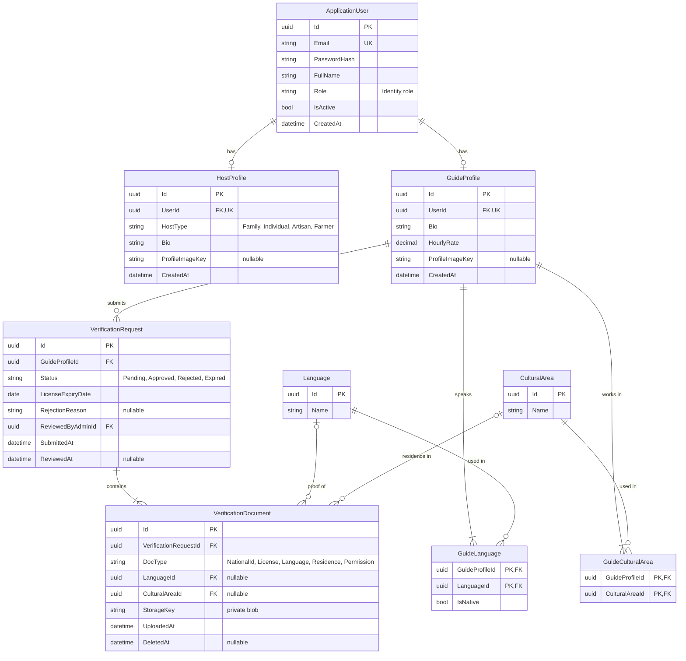
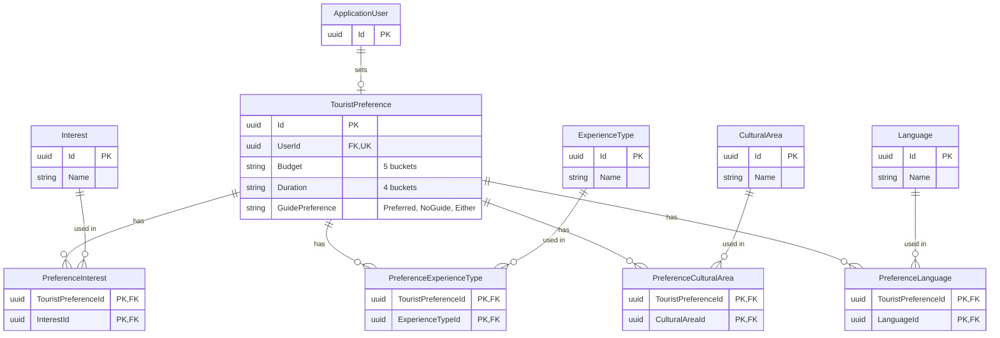
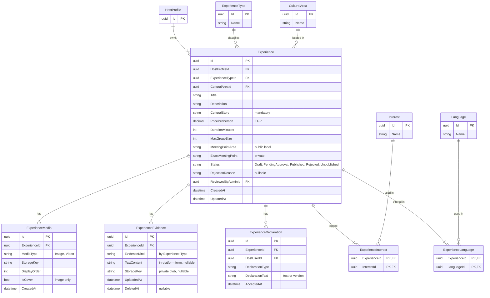
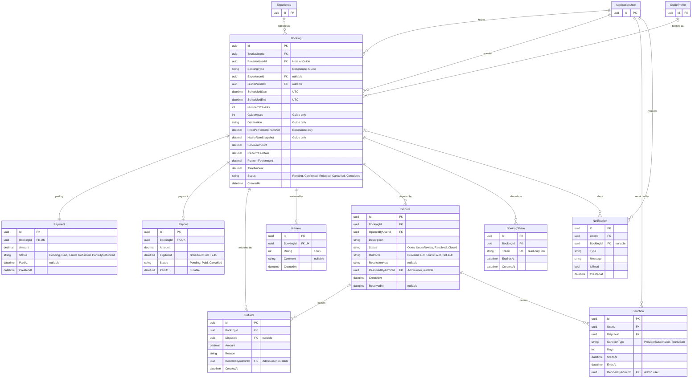

# Discover Egypt - ERD

Based on DEPI GP Context V2.0. The diagrams use Mermaid `erDiagram` (rendered natively on GitHub and in VS Code with a Mermaid extension).

Notes:
- All Ids are Guid.
- Any `*AdminId` column is an FK to `ApplicationUser` (Admin role).
- Enums are columns, not tables.
- `Role` on `ApplicationUser` comes from ASP.NET Core Identity roles.
- A table that appears in more than one diagram is shown with its `Id` only in the secondary diagrams.
- Join tables (8 total) have a composite PK made of two FKs.

---

## 1. Accounts, profiles and Guide verification

---

## 2. Tourist preferences

---

## 3. Experiences, media and evidence

---

## 4. Bookings, payments, disputes and notifications

